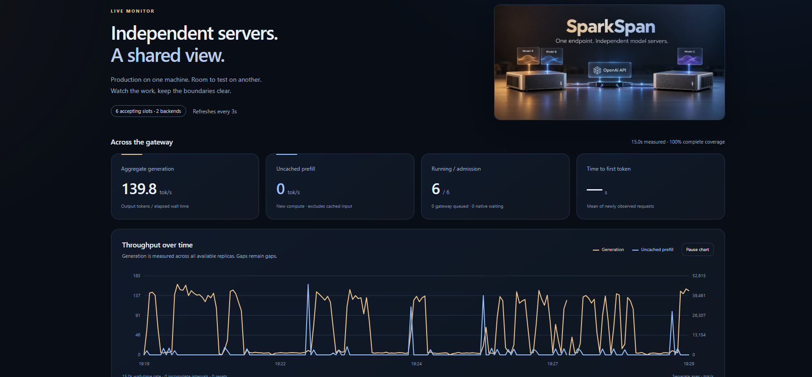

# SparkSpan Dashboard

A local control room included with [SparkSpan](../README.md), running separately from the inference servers. It combines a live monitor, rolling windows, deliberate benchmarks and admission controls. It listens on port 11002 by default and does not replace existing model dashboards.

The application, HTML, CSS, JavaScript and SVG chart drawing are custom code written for this project. There are no frontend templates, component packages, chart libraries, CDN requests or external fonts. FastAPI, HTTPX and Uvicorn supply standard Python HTTP infrastructure.



This captured interface illustrates the layout. Displayed rates are a momentary sample, not a controlled or sustained benchmark.

## What it shows

- Aggregate generation and uncached prefill rates from native counter deltas divided by actual elapsed wall time.
- Cached prompt share, request prefill duration, prefill compute mean and mean time to first token as separate measurements.
- Per-backend health, admission, native load, gateway in-flight work, KV use and metric age. Native load includes requests arriving through direct clients or other gateways.
- Served models and aliases without counting aliases as separate model throughput.
- One-minute, five-minute, fifteen-minute and one-hour summaries, plus charts over up to 24 hours of local history.
- Optional isolated test engines with separate health, model discovery, counters and benchmark scope. Their activity never enters the production aggregate or gateway configuration.

Production counters come from the configured SparkSpan gateway's `/metrics`; readiness and routing come from `/admin/status` and `/v1/models`. Isolated engines are sampled directly using `/health`, `/metrics` and `/v1/models`. SSE delivers dashboard state; no model inference is triggered by viewing any page.

## Reading the metrics

The live cards use the last 15 seconds of available counter intervals. A newly started dashboard initially has a shorter actual window; the UI reports its duration. Requests, generation and prefill are not inferred from display refresh counts.

Uncached input uses `prompt_tokens_by_source_total{source="local_compute"}` when available, falling back to prompt tokens minus cached prompt tokens only when both counters exist. Cached input remains separate. Request prefill duration uses native prefill histogram sum/count deltas. Prefill compute mean divides completed-request computed tokens by native request-prefill seconds; it is labelled `tok/prefill-s` and is not the wall-time capacity of the pool.

Rolling windows use actual sample boundaries. Counter resets, engine marker changes, missing backends, model changes and long sampling gaps reset the affected baseline. Incomplete aggregate rates are unavailable instead of displaying invented zero throughput or reset spikes. A configured backend drained and offline is excluded from expected production coverage; a draining backend with existing work remains expected. Partial boundary intervals are proportionally weighted and labelled approximate at the boundary.

History is stored in local SQLite files for up to 24 hours. A dashboard restart retains historical intervals but establishes fresh native counter baselines. No production prompts or responses are collected. Native counters are subject to the engine's own accounting timing; these charts do not measure GPU kernel execution directly.

## Controls and their limits

The Admin page can atomically edit backend capacity, backend draining and shared host request budgets. It checks the full configuration revision before saving, preserves existing secrets and unrelated settings, and saves a private rollback revision. Invalid and stale edits are rejected without overwriting the settings file. Rollback restores admission fields only and rejects changed backend identities.

A successful save means the settings file was written. It does not mean a gateway has already polled and applied it. The page separately displays each backend's live slots, draining status, native load and freshness. Keep the settings directory mounted into the gateway so atomic replacement remains visible.

Backend names, URLs, model filters, host identities and engine settings cannot hot-reload through the current gateway. The configuration editor saves such changes as a local deployment draft only. It does not deploy, restart containers, change firewall rules or start models. Secrets are redacted from browser responses and sanitized exports and remain preserved in private runtime files.

To reserve a machine for testing, enable draining and wait for fresh native running/waiting and gateway in-flight counts of zero across at least two polling intervals. Check that direct clients and every older gateway have also stopped assigning work. An unreachable engine is not proof of a completed drain. Restore the intended production model before resuming it. Reserving one of two six-slot backends leaves six production slots and can increase queueing or latency.

Control requests require a same-origin session, a CSRF token, JSON bodies and an allowed Host header. There is no account login or TLS layer. This is a trusted-LAN control surface; use an authenticated ingress or network restrictions if needed beyond that environment. Server logs do not record upstream error bodies, prompts or secrets.

## Benchmarks

Choose a scope explicitly: the production gateway or an independently configured isolated test target. Then select a currently advertised model, optional matching production backend, streaming/non-streaming mode, concurrency 1/6/12, request count, output limit and prompt. Check the real-workload confirmation and press Run.

Jobs are limited to one at a time, 48 requests, 1,024 output tokens per request and 24,576 output tokens per job, with a five-minute request timeout. Production tests respect gateway admission and draining; isolated tests call only their configured test engine. Target URLs are server-side configuration and cannot be supplied by a browser request. Thinking is disabled for benchmark requests. Prefix caches are not cleared, so these are not promised cold-cache tests.

Streaming TTFT starts at the first actual content, reasoning or tool delta, excluding empty role chunks. Output token counts come from server-reported usage, never chunk or character counts. Non-streaming jobs do not report TTFT. Exact aggregate output throughput is published only for a fully completed job with usage on every request. Cancelled, failed or missing-usage jobs retain their known counts and elapsed time without inventing a complete rate.

Cancel closes active HTTP/SSE connections, cancels waiting job tasks and records the result. The engine controls when it notices the disconnect. Results and JSON/CSV exports contain operational measurements and a hash/length of the benchmark prompt, not the prompt or generated content. Benchmark history is stored locally; production request history is not captured.

## Setup

Use Python 3.12 or later and a current SparkSpan gateway with native metrics and draining support. Run the following commands from the repository root. For the default Compose installation, use `http://127.0.0.1:8888` as `gateway_url`; point `gateway_config` at the same `settings/config.json` mounted into the gateway. Every path in the dashboard configuration must be absolute. An unavailable gateway is shown as unavailable; the dashboard does not start or replace it.

```bash
python3 -m venv /path/to/runtime/venv
/path/to/runtime/venv/bin/pip install -r dashboard/requirements.txt
cp dashboard/config.example.json /path/to/runtime/config.json
# Edit paths, allowed hosts, gateway settings and optional isolated targets.
SPARKSPAN_DASHBOARD_CONFIG=/path/to/runtime/config.json \
  /path/to/runtime/venv/bin/python -m uvicorn dashboard.app:app \
  --host 0.0.0.0 --port 11002 --no-access-log --no-proxy-headers
```

Keep the runtime directory and configuration outside Git and accessible only to the operating user. The service needs read access to gateway settings and write access to that settings directory for atomic admission edits. It needs no Docker socket or GPU access.

An editable user-service example is provided in [deploy/sparkspan-dashboard.service](deploy/sparkspan-dashboard.service). Set its paths, copy it into the user systemd directory, then enable only that unit. User services require a login session or systemd lingering to start after reboot. The service restarts on failure, has a 512 MiB memory limit and one CPU quota, and never starts a benchmark on startup.

The dashboard is published in the SparkSpan repository. No project license has been selected; see the [repository license notice](../README.md#license).

## Validation

```bash
/path/to/runtime/venv/bin/pip install -r dashboard/requirements-dev.txt
/path/to/runtime/venv/bin/playwright install chromium --only-shell
/path/to/runtime/venv/bin/python -m pytest -q dashboard/tests
```

Tests use temporary configuration files and local fake model engines. They exercise irregular wall time, counter resets, missing backends, model separation, stale revisions, rollback, invalid edits, secret redaction, same-origin checks, exact token usage, benchmark cancellation and isolated target routing. The browser test exercises actual pages, admin edits and benchmark run/cancel against those fakes, plus mobile layout, keyboard access and reduced motion. The repository-level test command also covers the gateway and deployment helpers. They do not send GPU benchmark requests.

Live browser verification on 11002 is read-only. It confirms real discovery, counters and rendering separately from mocked functional tests. Tests and preview deployment leave the production gateway settings, running engines and dashboard 11001 untouched.

## Credits

[SparkSpan](https://github.com/x00byte/SparkSpan) provides gateway status, routing, admission controls and the cover illustration reused here. [vLLM](https://github.com/vllm-project/vllm) provides inference and native engine counters. [FastAPI](https://github.com/fastapi/fastapi), [HTTPX](https://github.com/encode/httpx) and [Uvicorn](https://github.com/Kludex/uvicorn) provide Python HTTP infrastructure. [Playwright](https://github.com/microsoft/playwright-python) supplies browser automation for tests. No code from the previous dashboard is copied into this application.
